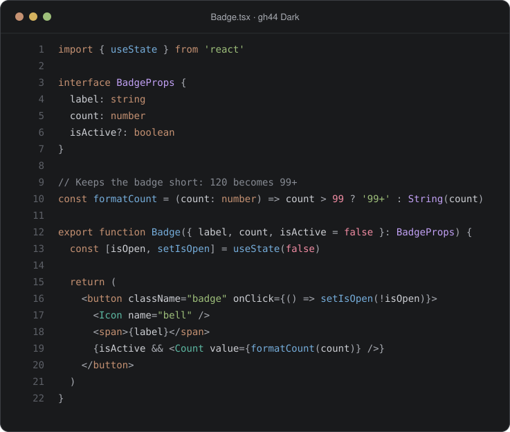

# gh44 theme

One palette for every tool I use, in dark and light.



| App                  | What you get                             |
| -------------------- | ---------------------------------------- |
| [Zed](zed/)          | Editor theme                             |
| [Warp](warp/)        | Terminal theme                           |
| [GitHub](github/)    | Userstyle for the interface and code     |
| [Linear](linear/)    | Interface theme and code block userstyle |
| [Slack](slack/)      | Sidebar theme                            |
| [Chrome](chrome/)    | Browser theme                            |
| [shadcn/ui](shadcn/) | Theme for shadcn projects                |
| [Palette](palette/)  | Color tokens and `gh44.css`              |
| [Fonts](fonts/)      | Lilex for code, IBM Plex Sans for text   |

## Build

Every theme is generated from [`palette/tokens.json`](palette/tokens.json):

```sh
node scripts/build.mjs
```

## License

MIT
