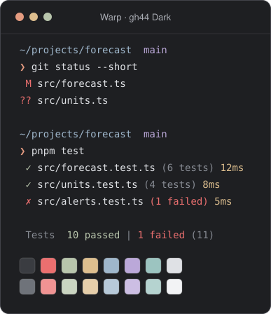

# gh44 for Warp

gh44 theme for the [Warp](https://www.warp.dev) terminal.

<picture>
  <source media="(prefers-color-scheme: light)" srcset="../assets/warp-light.svg">
  
</picture>

## Install

1. Create Warp's themes folder.

   macOS:

   ```sh
   mkdir -p ~/.warp/themes
   ```

   Linux:

   ```sh
   mkdir -p ${XDG_DATA_HOME:-$HOME/.local/share}/warp-terminal/themes
   ```

   Windows (PowerShell):

   ```powershell
   New-Item -Path "$env:APPDATA\warp\Warp\data\themes\" -ItemType Directory
   ```

2. Copy both theme files into it. On macOS:

   ```sh
   cp gh44-dark.yaml gh44-light.yaml ~/.warp/themes/
   ```

3. Open **Settings → Appearance → Themes** and pick **gh44 Dark**.

Warp can take a few minutes to notice a new themes folder the first time.
Restarting Warp speeds that up.

## Editing

The YAML files are generated. Change `palette/tokens.json` and run
`node scripts/build.mjs` from the repository root.
