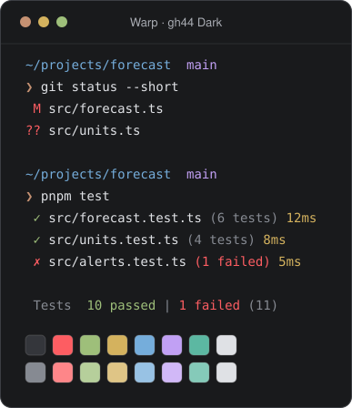

# gh44 for Warp



## Install

1. Copy the themes into Warp's themes folder. On macOS, from the repository root:

   ```sh
   mkdir -p ~/.warp/themes && cp warp/*.yaml ~/.warp/themes/
   ```

   | OS      | Themes folder                                               |
   | ------- | ----------------------------------------------------------- |
   | macOS   | `~/.warp/themes`                                            |
   | Linux   | `${XDG_DATA_HOME:-$HOME/.local/share}/warp-terminal/themes` |
   | Windows | `%APPDATA%\warp\Warp\data\themes`                           |

2. Open **Settings → Appearance → Themes** and pick **gh44 Dark** or **gh44 Light**.
   Restart Warp if they don't show up.
3. For the font, install Lilex from [`fonts/`](../fonts/) and pick it under
   **Settings → Appearance → Text**.

## Edit

These files are generated. Edit [`palette/tokens.json`](../palette/tokens.json) and run `node scripts/build.mjs` from the repository root.
