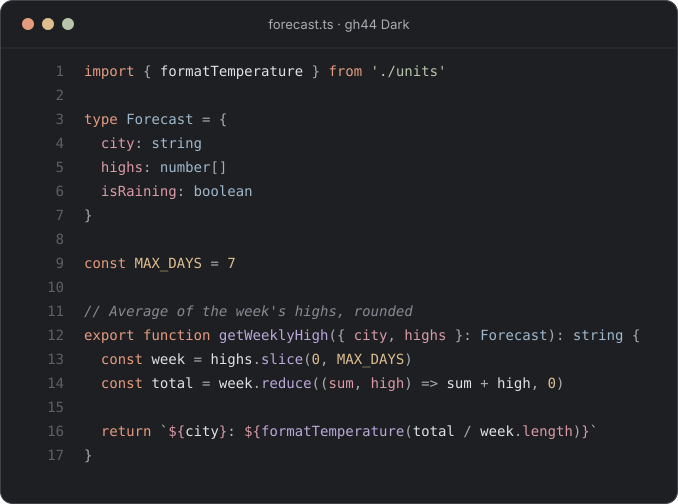

# gh44 for Zed

gh44 theme for the [Zed](https://zed.dev) editor.

<picture>
  <source media="(prefers-color-scheme: light)" srcset="../assets/zed-light.svg">
  
</picture>

## Install

**From the Zed extension registry** run: `zed: extensions`
from the command palette, search for `gh44`, and install it.

**From this repository:**

1. Clone the repository.
2. In Zed, run `zed: install dev extension` and select this `zed` folder.
3. Run `theme selector: toggle` and choose **gh44 Dark**.

<details>

Fonts, sizes and editor visuals. It uses Lilex for code and IBM Plex Sans for
the interface. Zed bundles both as `.ZedMono` and `.ZedSans`, so there's
nothing to install.

```jsonc
{
  // Theme
  "theme": {
    "mode": "system",
    "light": "gh44 Light",
    "dark": "gh44 Dark"
  },

  // UI font
  "ui_font_family": ".ZedSans",
  "ui_font_size": 16.0,
  "ui_font_weight": 400.0,

  // Buffer font
  "buffer_font_family": ".ZedMono",
  "buffer_font_size": 14.0,
  "buffer_font_weight": 400.0,
  "buffer_line_height": {
    "custom": 1.8
  },

  // Editor visuals
  "cursor_animation": {
    "enabled": false
  },
  "colorize_brackets": false,
  "indent_guides": {
    "enabled": false
  },
  "selection_highlight": true,
  "show_wrap_guides": false,
  "gutter": {
    "git_gutter_width": "default"
  },

  // Project panel
  "project_panel": {
    "folder_indicator": "icon",
    "file_icons": true,
    "git_status": true,
    "indent_size": 10,
    "entry_spacing": "standard"
  },

  // Terminal
  "terminal": {
    "cursor_shape": "bar",
    "minimum_contrast": 45.0,
    "font_family": ".ZedMono",
    "font_size": 14.0,
    "font_weight": 400,
    "line_height": "comfortable"
  },

  // Markdown preview
  "markdown_preview": {
    "font_size": 14.0,
    "font_family": ".ZedSans",
    "code_font_family": ".ZedMono"
  },

  // Agent panel
  "agent_ui_font_size": 14.0,
  "agent_buffer_font_family": ".ZedMono",
  "agent_buffer_font_size": 14.0
}
```

</details>

## Editing

Don't edit `themes/gh44.json` directly. Change `palette/tokens.json` and run
`node scripts/build.mjs` from the repository root.
